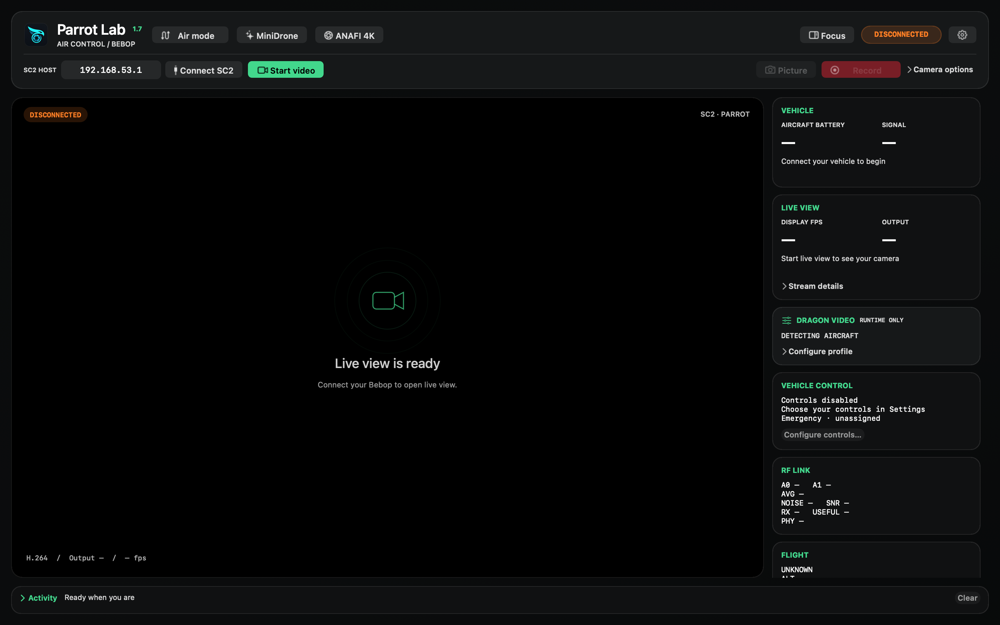
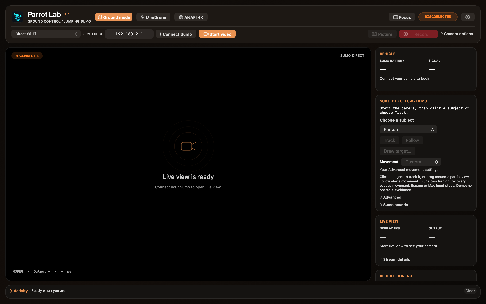

# Parrot Lab for macOS

Parrot Lab is a native macOS HUD and diagnostic client for the Parrot
SkyController 2, Bebop Drone (BB1), Bebop 2, Jumping Sumo, Mambo, and experimental
ANAFI 4K / SkyController 3 network support. It is intentionally built from
Apple system frameworks rather than Electron or an embedded browser.

See [CHANGELOG.md](CHANGELOG.md) for the V1.7 release highlights and known
limitations, and [RELEASING.md](RELEASING.md) for packaging instructions.

## New in 1.7

- Mac-side Sumo subject following for people, legs, cats and manually selected
  targets, with motion presets, target recovery and built-in sound controls.
- Experimental ANAFI 4K workspace for video, camera modes, gimbal/zoom, SD
  capture and Mac recording through Direct Wi-Fi or SC3 network routes.
- Experimental SC3 Sumo relay/native viewer routes, video startup tools and
  SC3 RF Lab with explicit preview/save and readback.
- SC2 libmux session, discovery and video-channel support behind a raw USB
  adapter boundary; the macOS accessory adapter still needs validation.
- More reliable reconnects, input neutralization, recording/conversion
  cancellation and bounded video cleanup, plus refined menus and settings.

ANAFI and SC3 paths remain experimental. Flypad is currently unsupported.

| Air workspace | Ground workspace |
| --- | --- |
|  |  |

The cockpit keeps connection controls on the first toolbar row and video/media
controls on the second. **Focus** hides the right inspector; **Inspector** brings
it back. Expand **Stream details** for transport statistics and the editable RTP
port, or **Configure profile** for Dragon controls. **Activity** opens the full
event log while its collapsed bar still shows the latest event. Air and ground
workspaces use blue and copper accents respectively.

> [!WARNING]
> **Development preview — not flight-ready.** The app now receives live video
> through the established SC2 route. The 1.7 libmux session is implemented, but
> its macOS AOA/iAP2 descriptor adapter still needs live hardware validation.
> Dragon Lab restarts the drone's flight process and must only be
> used while landed with the props removed. Do not rely on this build as a
> flight display or as a replacement for FreeFlight.

The intended production transport is the SC2 mobile link used by FreeFlight:
BB1, BB2 or Sumo video and telemetry arrive at `mppd` over Wi-Fi and are
forwarded through Parrot's USB `libmux` channels. Version 1.7 implements the
mux handshake, product discovery, backend connection, ARNetwork transport and
RTP channel routing behind a duplex descriptor boundary. Opening the raw
AOA/iAP2 descriptor on macOS remains the platform-specific step.

Parrot Lab also provides:

- preliminary Bluetooth MiniDrone/Mambo control with discovery, battery/flight
  telemetry, keyboard/gamepad input, and cannon/grabber accessory controls—see
  [MINIDRONE.md](MINIDRONE.md);
- a large **Ground Mode** switch with a brown ground-vehicle theme and a direct
  Jumping Sumo backend (`0x0902`, `_arsdk-0902._udp`);
- native JumpingSumo speed/turn PCMD at 20 Hz with the same bounded keyboard
  and macOS GameController input system used by BB1/BB2;
- codec-neutral ARStream1 fragment/ACK handling, routing BB1 to Annex-B H.264
  and Jumping Sumo to a bounded MJPEG decoder;
- Sumo MJPEG frames flowing through the existing enhancement, MetalFX,
  screenshot and processed H.264 recording pipeline;
- strict capability gating that hides flight/GPS/Dragon/RF controls and never
  sends ARDrone3 flight commands while Ground Mode is active;

- direct, read-only Telnet connection to the SC2 at `192.168.42.88`;
- parsing of the SC2's existing `mppd`, `wifid`, and link-quality telemetry;
- a persistent SC2-routed ARDiscovery/ARNetwork/ARCommands session for
  structured drone battery, flight state, GPS, speed, attitude, satellite and
  camera events;
- automatic BB1/BB2 model detection from the authoritative SkyController
  `ConnexionChanged` product ID (`0x0901` / `0x090c`), with direct Bonjour
  discovery of `_arsdk-0901._udp` and `_arsdk-090c._udp`;
- stock Compatibility video, telemetry, piloting, camera control and genuine
  4K fisheye capture on both BB1 and BB2;
- automatic safety gating that keeps BB2-only modified Dragon, calibrated
  rolling-shutter, persistent-Telnet and RF/MOD workflows disabled on BB1 or
  an unidentified aircraft;
- an optional standalone BB1/BB2 route using direct ARDiscovery at
  `192.168.42.1:44444`, the discovery-returned command port, and announced
  ARStream2 client ports;
- native macOS GameController input for Xbox, PlayStation and MFi controllers,
  plus app-focused remappable keyboard controls that require a safety-hold key
  for movement;
- SC2-style 20 Hz PCMD control, acknowledged take-off/landing/RTH commands,
  camera pan/tilt control, automatic neutral input on focus/connection loss,
  and an intentionally unassigned emergency command;
- per-chain RSSI, noise, SNR, PHY rate, flight state, altitude, attitude, controller battery and temperature;
- a graphical video HUD with the RF Lab red/yellow/green/cyan signal gradient;
- an artificial horizon and live link/video statistics;
- SC2 `/video` restream discovery on the two listeners observed in firmware 1.0.9;
- a UDP/RTP H.264 receiver with FU-A and STAP-A reassembly and low-latency AVFoundation display;
- bounded VideoToolbox H.264 recording of the processed Parrot Lab output;
- an optional developer-only archive of the untouched incoming Annex-B stream;
- original-quality H.264-to-MP4 remuxing plus an optional quality-controlled
  H.264 re-encode from the native **Video** menu;
- PNG or JPEG capture of the latest processed output frame at the selected
  enhancement/MetalFX resolution;
- independent Core Image enhancement and configurable Apple MetalFX Spatial
  output up to 3840 × 2160, shared by live view, stills and normal recording;
- optional GPU H.264 artifact repair for isolated green/odd-color blocks and
  confidence-gated temporal mosquito-noise cleanup;
- experimental, developer-controlled 900p temporal reconstruction with
  synchronized IMU alignment, dense residual optical flow and occlusion/
  ghost rejection;
- performance-scaled residual flow plus optional motion-compensated 2:1
  midpoint generation (30 source + 15 generated frames for a 45 FPS output);
- an automatic temporal-performance governor and bounded 45 Hz presentation
  queue, targeting at least 30 displayed FPS without allowing latency to grow;
- a guarded, non-persistent Dragon Video Lab for resolution and bitrate tests;
- verified one-click deployment of Dragon Lab and the RF/MOD Suite from the
  native **Tools** menu;
- a guarded SC2 1.0.9 Apple-NCM driver installer with verified FTP staging,
  on-device digest checks and an explicit controller reboot;
- a self-contained FFmpeg recovery decoder with its non-system dependencies
  embedded in the application bundle;
- an ad-hoc-signed, double-clickable Apple-silicon `.app` bundle.

Normal connection and video operation perform no RF/NVM writes. Optional device
tools have their own explicit write/restore workflows; see the relevant tool
documentation before using them. Dragon Lab never edits
`persist.dragon-prog.post_cmd`; it can explicitly stop and relaunch Dragon with
runtime-only arguments after a landed-state check. Applying a Dragon runtime
profile is immediate and does not show an additional confirmation sheet.

## Requirements

- macOS 13 or later on Apple silicon;
- a supported vehicle: Bebop/BB2, Jumping Sumo, Mambo, or experimental ANAFI 4K;
- a network route appropriate to the selected mode: direct Bebop normally
  `192.168.42.1`, direct Sumo `192.168.2.1`, or the controller's current address
  (SC2 normally `192.168.42.88`, Apple-NCM commonly `192.168.53.1`);
- SC2 Telnet on TCP 23 for its diagnostic and deployment tools; BLE MiniDrone
  control uses Bluetooth instead—see [MINIDRONE.md](MINIDRONE.md);
- Local Network or Bluetooth permission when macOS requests it. Experimental
  routes have additional prerequisites in their linked guides.

## Current macOS release status

Parrot Lab is currently distributed as an **ad-hoc-signed, non-notarized
development build** because the project does not yet use a paid Apple Developer
ID certificate. The release contains a normal macOS `.app`, but Gatekeeper may
block its first launch.

Testers should extract the ZIP, move **Parrot Lab.app** to `/Applications`,
then right-click the app, choose **Open**, and confirm **Open**. If macOS still
refuses to launch it, advanced users can remove quarantine from this app only:

```sh
xattr -dr com.apple.quarantine "/Applications/Parrot Lab.app"
```

Do not disable Gatekeeper globally. See [RELEASING.md](RELEASING.md) for the
complete maintainer workflow and tester instructions.

## Build the application

From this directory:

```sh
./scripts/build-app.sh
```

By default, this verifies and installs only the local ad-hoc-signed app at
`~/Applications/Parrot Lab.app`. Existing distributable archives are untouched.
Build and update the release ZIP only when explicitly needed:

```sh
./scripts/build-app.sh --release
```

The release mode also updates the archive and its checksum:

```text
~/Applications/Parrot Lab.app
dist/Parrot-Lab-macOS-arm64.zip
dist/Parrot-Lab-macOS-arm64.zip.sha256
```

To ad-hoc sign and package an already assembled bundle independently:

```sh
./scripts/package-macos-release.sh "/path/to/Parrot Lab.app"
```

The packager fails on any signing, strict verification, self-test, ZIP
integrity, or post-extraction signature error. It uses no Apple credentials,
paid signing identity, provisioning profile, or notarization secret.

Release builds require an arm64 FFmpeg executable. The build first reuses the
one in the installed Parrot Lab app when available, then checks the usual
Homebrew locations. For a clean build or a specific FFmpeg build, provide it
explicitly:

```sh
PARROTLAB_FFMPEG=/absolute/path/to/arm64/ffmpeg ./scripts/build-app.sh
```

The executable is copied to
`Contents/Resources/ffmpeg-parrotlab`. The packager recursively copies every
non-system Mach-O dependency into `Contents/Frameworks`, rewrites the load
paths to bundle-relative locations, and verifies that the bundled executable
starts without `DYLD_*` overrides. A release fails if FFmpeg is missing, has no
arm64 slice, or retains an unresolved external dependency. Testers do not need
Homebrew or a separate FFmpeg installation.

You can also build and test only the executable:

```sh
swift build
.build/debug/ParrotLab --self-test
```

For an off-screen HUD render suitable for UI regression checks:

```sh
.build/debug/ParrotLab --render-preview /tmp/parrot-lab-preview.png
```

For the complete application window:

```sh
.build/debug/ParrotLab --render-app-preview /tmp/parrot-lab-app-preview.png
```

## Local pictures and recordings

The **MEDIA** controls in the top toolbar save directly on the Mac:

- **Browse…** selects the destination directory. The choice is remembered;
- **Record** encodes Parrot Lab's processed GPU output through the hardware
  VideoToolbox H.264 encoder. Select it again to stop and finalize the
  duration-bearing filename;
- **PNG/JPEG** chooses the still-image format;
- **Picture** saves the latest processed output frame without the HUD overlay,
  at the enhancement/MetalFX resolution currently shown by the live view;
- **Drone 4K Fisheye** is a separate stock-camera action. It sends Parrot's
  `jpeg_fisheye` photo-format command through the SC2, waits for the camera's
  ready/busy/ready sequence and successful photo event, then finds the new
  JPEG below the aircraft's enumerated `internal_000/<product>/media/`
  directory. The original drone JPEG is downloaded unchanged and can be
  revealed in Finder from the completion dialog. The live preview may pause
  while stock Dragon captures the full-sensor photo and should resume itself.

The default destination is `~/Movies/Parrot Lab`. Filenames use local time:

```text
PictureBB2-2026-08-21_18-32-45.png
VideoBB2-2026-08-21_18-32-45-03m17s.h264
```

Normal recording is now one deliberate lossy generation after processing:

```text
Bebop H.264 → decode → enhancement / MetalFX → VideoToolbox H.264
```

The encoder input is the same selected processed resolution shown by the live
view. It uses a latest-frame-only pre-encoder slot, at most three submitted
frames in flight, and a 16 MiB disk queue. If recording cannot keep up it drops
or stops explicitly; it can never make the FPV display accumulate latency.
The **Tools → Developer → Archive Original H.264** option can
simultaneously create a separate `RawVideoBB2-…h264` diagnostic file. That raw
archive preserves Dragon's original NAL units and SEI, but is not the normal
user-facing recording.

At 100%, the H.264-to-MP4 tool stream-copies the already processed Parrot Lab
recording. It does not perform a second lossy encode.

## Video receive modes

Choose a mode before starting video:

- **Compatibility · Recovery decoder** preserves the proven FFmpeg recovery
  path for the stock Bebop cyclic-intra-refresh stream.
- **900p Modified · FrameInfo** prefers VideoToolbox for the validated
  1600 × 900 stream produced by `-V 2 -q 1000 -o`.
- **900p Temporal · FrameInfo** uses the same bounded receiver for the
  stabilized 1600 × 900 stream produced by
  `-V 2 -f 30 -R gpu -S 0 -q 12000 -o`.

Both 900p modes automatically fall back to the recovery decoder if no
hardware-decoded frame appears within three seconds.

Receiver mode selection alone never writes or persists Dragon configuration.
The separate **Dragon Video** card can apply a matching runtime profile. In
either 900p mode, the app detects the legacy FrameInfo V3
UUID in type-6 H.264 SEI and decodes the official 56-byte Parrot
VideoMetadataV2 record carried in the RTP header extension. The record is
attached to the access unit by its exact 90 kHz RTP timestamp and supplies
synchronized drone/view quaternions, camera pan/tilt, exposure, speed and
other frame telemetry. Captured data established the exact relationship
`RTP timestamp = round(FrameInfo timestamp_us × 90000 / 1000000)` for every
frame, with a contiguous FrameInfo counter. This is frame-synchronized
orientation from Dragon's IMU pipeline, not a claim that the stream carries
the full high-rate raw accelerometer/gyroscope sample sequence. Parrot Lab
also preserves the first capped set of raw
RTP header extensions in `/tmp/parrotlab-rtp-extensions.bin`. The matching
capped Annex-B capture is `/tmp/parrotlab-capture.h264`.

The decoded callback feeds an IOSurface-backed, latest-frame-only processing
queue. Its bounded three-frame temporal history is reset on timestamp
discontinuity and exposes whether synchronized motion is available. Quaternion
signs are made continuous before history association because `q` and `-q`
represent the same rotation. The pipeline does not average frames blindly.

### Calibrated 4.7.1 900p camera geometry

Parrot Lab contains the measured 1600 × 900 camera model, full-fisheye
projection, native sensor mapping and curved per-pixel row timing for this
specific source profile:

- Bebop/Dragon firmware 4.7.1;
- patched 1600 × 900 visible stream;
- Dragon GPU reprojection with onboard stabilization retained (`-R gpu -S 0`);
- the fixed raised SC2 virtual-camera position used for calibration;
- coordinates before Parrot Lab scaling.

The app can generate immutable Metal camera-ray, row-time and validity
textures at 1600 × 900. The timing texture uses the fisheye-to-sensor mapping,
not a linear output-X approximation: the active readout is 31.167 ms at a
14.7571 µs line period and its equal-time contours curve near the sides.

This calibration must not be applied to 4.4.2 or another virtual-camera
position. H.264 does not identify all source-side choices, so **Motion
Correction → 4.7.1 900p Calibrated Jello Correction** is off by default;
turning it on is the source-profile confirmation. The normal 900p Dragon Lab
profile uses `-R gpu -S 0` and retains Dragon's onboard stabilization.

### Calibrated rolling-shutter correction

VideoMetadataV2 quaternions use Q14 `(w,x,y,z)` Hamilton algebra. `frame_quat`
is used directly as the active displayed camera/view FRD → global NED rotation;
`drone_quat` is not multiplied into it. Rays use camera FRD coordinates
`[forward,right,down] = [1,(u-cx)/fx,(v-cy)/fy]`.

The RTP/FrameInfo timestamp is the V4L2 frame-DMA completion timestamp (frame
EOF). For calibrated sensor row `k = sensor_y - 610`, the shader evaluates:

```text
t_mid(k) = T_metadata - (2112-k) × 14.7571 µs - exposure/2 - δIRQ
```

`δIRQ` currently defaults to zero. Consecutive `frame_quat` samples are
shortest-path SLERPed at the curved per-pixel exposure time. A two-pass inverse
Metal warp rotates every valid camera ray into the center-time frame view and
projects it back through the 900p intrinsics. Correction is capped at 6° per
frame, invalid calibration edges remain pass-through, and failure or missing
metadata always falls back to the untouched frame. Processing and processed
recording remain latest-frame-only and bounded.

### Experimental temporal reconstruction

For Jumping Sumo, enable **Video → Sumo Motion Smoothing**.
This works with either direct Wi-Fi or the SC2 JPEG restream. The ground preset
uses image-only bidirectional motion estimation, a lighter history blend and
photometric/occlusion rejection—no IMU or Bebop calibration. Settings controls
adjust the active product's preset; ground and air preferences are separate.

With the 30 FPS firmware, one midpoint is generated per two real frames, targeting
45 FPS. Actual display FPS remains measured; low-confidence regions use the
current image, and missing-frame gaps or non-30-FPS cadence suppress interpolation.
Latest-frame processing and bounded display/recording queues remain in place.
MetalFX scales processed real and generated frames to 720 pixels high, with GPU
Lanczos fallback. Aspect ratio is preserved: 640×480 becomes **960×720**, while
16:9 input produces **1280×720**. This is enhanced/upscaled output, not native
720p camera detail. The processed recording and screenshots use this output too.
Disable the ground preset to restore the ordinary scaler selection. Stop an
active recording before changing the preset.

**Parrot Lab → Settings → Experimental temporal reconstruction** enables a
bounded causal reconstruction pass for the 1600 × 900 source. It is off by
default. The prior source/history is first aligned with the exact
RTP-associated `frame_quat`; Apple Vision then estimates the remaining dense
image motion. The GPU resolve accepts history only where photometric confidence
and, by default, forward/backward flow consistency indicate that it is safe.
This provides motion-compensated temporal denoising/anti-aliasing without
blindly averaging moving objects.

Settings expose history strength, ghost rejection, occlusion-consistency
threshold and a strict flow-latency budget. Any dimension/timestamp
discontinuity, missing resource, failed flow, or budget overrun discards the
result and resets history to the current frame. Processing remains
latest-frame-only; temporal work can reduce processed FPS but cannot add an
unbounded FPV queue. Detailed developer video diagnostics show flow latency
and whether history was used or reset.

The optional **Video → Image Enhancement → H.264 Artifact Repair** pass is independent of the heavier optical-flow feature. A
Metal shader identifies locally coherent chroma blocks that disagree with
several surrounding regions, including isolated decoder-green corruption. It
also applies conservative edge-aware spatial cleanup and a single-frame,
confidence-gated temporal chroma resolve for mosquito shimmer. Selecting a
different enhancement immediately clears its one-frame history. It cannot
reconstruct detail that was never received; irrecoverable packet-loss damage
still requires a clean reference frame from the encoder.

Frame interpolation remains a separate future feature; temporal reconstruction
does not synthesize 60 fps frames.

## Dragon video runtime controls

Dragon Video offers four documented runtime profiles:

- **Stock 856 × 480** uses `/usr/bin/dragon-prog -V 1`;
- **Stock 1280 × 720** uses `/usr/bin/dragon-prog -V 2`;
- **900p Modified** uses the firmware-matched patched binary with
  `-V 2 -q 1000 -o`;
- **900p Temporal** uses the firmware-matched patched binary with
  `-V 2 -f 30 -R gpu -S 0 -q 12000 -o`.

The former 1080p experiment remains deprecated because it exceeded the
drone's sustainable video-processing capacity.

The 900p Temporal runtime action has no flight-state interlock. Selecting it
and pressing **Apply profile** is the authorization to queue the Dragon
restart. Other profiles, custom launches, and stock restoration retain the
fresh `LANDED` requirement.

The resolution menu also offers **Custom · modified binary**. Selecting it
reveals a command-line field and starts the uploaded modified binary with those
arguments instead of a preset. Custom input is normalized to
whitespace-separated tokens, limited to 512 bytes and 64 arguments, and rejects
shell metacharacters. The validated argument string is passed without `eval`;
the executable path itself cannot be changed from the UI.

The bitrate slider sets Dragon's `-q` streaming ceiling from 1 to 16 Mbit/s in
0.5 Mbit/s steps. **Lock bitrate** additionally supplies `-s`; leave it off to
retain Dragon's link adaptation. The helper selects the matching 4.4.2 or
4.7.1 patched binary. Neither 900p preset passes `-I off`; the 900p Temporal
preset keeps Dragon's GPU reprojection/stabilization enabled.

“Temporal” in the Dragon menu names the grounded source profile. Parrot Lab's
separate experimental temporal reconstruction is controlled under
**Parrot Lab → Settings** and is never enabled merely by selecting that Dragon
profile.

The app calls this helper through the SC2 drone-Telnet relay on TCP 2324,
falling back to direct Bebop Telnet at `192.168.42.1:23` only for bench use:

```text
/data/ftp/internal_000/parrotlab_dragon_video.sh
```

Before first use, choose **Tools → Device Tools → Bebop 2 → Install / Update Dragon Lab…**. The
app uploads these bundled files to the drone's writable `internal_000`
directory through the stock anonymous FTP service at `192.168.42.1:21`:

```text
tools/parrotlab_dragon_video.sh
  -> /data/ftp/internal_000/parrotlab_dragon_video.sh

patched/dragon-prog-900p-4.4.2
  -> /data/ftp/internal_000/dragon-prog-900p-4.4.2

patched/dragon-prog-900p-4.7.1
  -> /data/ftp/internal_000/dragon-prog-900p-4.7.1
```

It downloads all three uploads again and compares SHA-256 digests. Once FTP
verification succeeds, the app marks only these three app-owned files executable
and checks their MD5 digests on the drone. It first tries the SC2 relay, then
direct Bebop Telnet if needed; each connection attempt has an eight-second
deadline. Installation neither stops Dragon nor replaces the stock binary.

Before every Lab or custom launch, the helper reads
`ro.parrot.build.version` from `/etc/build.prop` and selects
`dragon-prog-900p-4.4.2` or `dragon-prog-900p-4.7.1`. Unsupported firmware is
rejected before the running Dragon process is touched. Before
stopping Dragon, the helper validates the complete request and starts a
detached worker through the firmware's `/usr/bin/setsid`, with stdin redirected
and HUP ignored. The helper explicitly restores the stock firmware command
path because manually enabled Telnet sessions may omit `/usr/bin`. Custom
arguments are passed as one validated shell argument; the stock drone does not
need a `base64` utility. It then
reports `QUEUED` to the app. The worker waits for that acknowledgement to leave
the Telnet socket, stops Dragon, and launches the requested process without
depending on the SC2 relay that Dragon teardown temporarily removes. It tries
a normal termination first and uses `SIGKILL` only if Dragon does not exit.
**Restore stock** uses the same detached transaction before relaunching
`/usr/bin/DragonStarter.sh`.

Drone battery and navigation state now arrive as native ARCommands through the
SC2 at controller RF range. Version 1.5 no longer opens a periodic Telnet relay
or direct-drone Telnet connection to scrape battery logs. The persistent ARSDK
session requests all states after connecting and refreshes them periodically;
the stock 4K fisheye capture reuses the same command connection.

Telnet remains intentionally limited to data and operations not supplied by
the Bebop ARCommands interface: SC2 RF-chain diagnostics and temperature,
Dragon Lab runtime control, and explicit installer tools.

Live testing established an ordering dependency in the current relay setup:
Bebop Telnet must be running before the SC2 associates with the aircraft. The
persistent Bebop Telnet tool makes that true on subsequent boots; for its
one-time installation, manually enable Telnet before connecting the SC2.

After installing a release containing this change, run **Tools → Device Tools → Bebop 2 →
Install / Update Dragon Lab…** once to replace the older foreground
helper on the drone. Worker state is recorded in
`/data/ftp/internal_000/parrotlab-dragon-video.state`; Dragon and worker output
remain available in `/tmp/parrotlab-dragon-video.log` and
`/tmp/parrotlab-dragon-worker.log` respectively.

Controls require a live SC2 connection. All profiles except 900p Temporal,
plus custom launch and stock restore, additionally require a flight-state
update from the last three seconds that explicitly says `LANDED`; they relock
if telemetry stalls. Applying or restoring is immediate once its applicable
conditions are satisfied. A
relay closure after `QUEUED` is treated as expected, and the UI changes from
queued to running when fresh drone telemetry returns. No setting is persisted
and no stock binary is replaced; a normal reboot is the final stock recovery
route.

## Tools menu uploads

The native macOS **Tools** menu contains deployment and discovery actions:

- **Bebop Flat Trim** sends the native ARSDK flat-trim command after live
  telemetry confirms that the Bebop is landed on a level, stationary surface;
- **Start/Stop Bebop Magnetometer Calibration** uses the native ARSDK
  calibration command and reports the requested X/Y/Z rotation progress from
  the aircraft's calibration-state events;
- **Install/Update Dragon Lab on Bebop 2** uploads and verifies the patched
  Dragon binary and helper at the fixed stock Bebop FTP address
  `192.168.42.1:21`;
- **Enable Persistent Telnet on Bebop 2…** uses one manually enabled Telnet
  session to install an app-owned Boxinit trigger that starts the stock Telnet
  service on future boots;
- **Upload RF/MOD Suite** uploads and verifies `parrot_rf_lab.sh` on the Bebop
  at `/data/ftp/internal_000/parrot_rf_lab.sh`;
- **Upload RF/MOD Suite to SkyController 2** uses the address currently shown
  in **SC2 HOST** and installs the same script at
  `/data/lib/ftp/internal_000/parrot_rf_lab.sh`;
- **Find SC2 IP through Bebop 2…** uploads a read-only helper to the Bebop,
  correlates the associated Parrot station with the Bebop ARP/dnsmasq lease
  state, then fills **SC2 HOST** and caches the bridge-side DHCP address;
- **Install/Update SC2 Driver Patch** uploads the production Apple-private NCM
  installer and matching ARMv7 `apple_mac_ncm.ko`. It tries a verified live or
  cached SC2 address first; after a connection failure it discovers the current
  SC2 address through the Bebop and resumes automatically.

All uploads use anonymous/no-credential FTP and download each uploaded
file for a byte-count and SHA-256 comparison. The RF/MOD actions only deploy
the script: they do not run it, apply an RF profile, edit NVM, or touch factory
files. It can be launched explicitly from the corresponding device shell with
`sh <device-path> menu`.

The persistent Telnet action is restricted to Bebop 2 firmware 4.4.2. Installer
and upload actions do not require an established Parrot Lab telemetry session;
their confirmation sheets remain available for bench-safety checks. It verifies
`install_bebop2_persistent_telnet.sh`, connects directly to
`192.168.42.1:23` and verifies the exact stock firmware files. Because the
system UBIFS is full, it backs up `/usr/sbin/tcpdump` to
`internal_000/parrotlab-system-backup`, verifies the backup and replaces the
original with a symlink. It then adds `/bin/usbnetwork.sh` immediately before
`exit 0` in `/etc/init.d/rcS`, following the stock four-button developer-mode
path. The installer syncs and returns `/` to read-only before reporting
success, and does not reboot the aircraft. The boot call enables the stock
no-password root Telnet service, ADB and USB developer networking. Anyone on
the aircraft network will therefore have root access. Remove the `rcS` call
with:

```text
sh /data/ftp/internal_000/install_bebop2_persistent_telnet.sh uninstall
```

The SC2 driver action supports a bootstrap workflow for controllers that do not
yet expose a usable Mac USB network connection. After a critical confirmation,
it runs these stages:

1. try the verified live/cached controller address; if it fails, upload and run
   `parrotlab_find_sc2_ip.sh` on the Bebop and cache the returned DHCP address;
2. upload `install_sc2_apple_ncm.sh` and `apple_mac_ncm.ko` through anonymous
   FTP to the controller's `internal_000` and verify their SHA-256 digests;
3. connect to SC2 TCP 23, compare on-device MD5 digests and apply mode `775` to
   the installer script;
4. run the installer, require its success marker, issue `sync`, and reboot the
   SC2.

The installer refuses firmware other than SkyController 2 1.0.9 or a kernel
other than `3.4.11+`. It persistently places the module and rollback helper
under `/data/lib/parrotlab`, removes obsolete Parrot Lab experimental RC
entries after backing them up, and writes one production Boxinit service named
`plboot`. The short name is required because SC2 Boxinit silently ignored the
older long service names. Rollback remains available on the controller at:

```text
/data/lib/parrotlab/uninstall_sc2_apple_ncm.sh
```

## Connect to the SkyController 2

1. Power the Bebop 2 and SC2 and wait for their link to settle.
2. Connect the Mac using the established USB/network route.
3. Leave the default SC2 address `192.168.42.88`, or replace it with the current DHCP address.
4. Select **Connect SC2**.

The app opens a Telnet connection and starts `ulogcat`. It does not log in with a credential and it does not write any device configuration. The captured lines are parsed locally; the full raw feed is not retained by default.

The SC2 already publishes the key HUD line at approximately five updates per second:

```text
rssi_mpp, rssi, flight state, altitude, latitude, longitude, roll, pitch, yaw
```

It separately publishes per-chain Broadcom values, link-quality percentages, controller temperature, and controller battery.

Values of `500` used by `mppd` as unavailable altitude/position sentinels are deliberately shown as unavailable rather than as real telemetry.

## Standalone BB1/BB2/Sumo and input controls

Open **Parrot Lab → Settings** to enable **Standalone aircraft**. Join the BB1
or BB2 Wi-Fi first; the app then locks the target to `192.168.42.1`, identifies
the model from its official Bonjour service, performs ARDiscovery on TCP 44444,
and uses the command UDP port returned by the aircraft. Standalone and
SkyController routes are mutually exclusive. For Jumping Sumo, use the large
**Ground Mode** switch before connecting. The app selects product `0x0902`,
discovers `_arsdk-0902._udp`, and uses direct ARStream1 MJPEG rather than the
Bebop H.264 path.

When driving Sumo through an SC2, use either physical controller input or Parrot
Lab keyboard/gamepad control at a time. Simultaneous PCMD streams can produce
choppy movement. The matched SC2 Sumo patch and manual association steps remain
in [experimental/jumping-sumo/README.md](experimental/jumping-sumo/README.md).

After connecting a gamepad, sweep both sticks fully in every direction and
release them to center once. The app learns each physical direction's maximum
independently, so asymmetric stick travel can reach the selected limit. Learning
also works before connecting a vehicle, while gamepad input is enabled and the
main app window has focus. Small movements below half travel are ignored. Ranges
update on release, can grow with wider sweeps, and reset on gamepad disconnect or
app restart. **Stick limit** still caps gamepad output; Ground Mode's **Drive
speed limit** additionally scales forward/backward speed.

Sumo gamepad steering uses a progressive cubic response: half of the usable
stick travel commands 12.5% of the selected turn limit, while full travel still
reaches that limit. This follows the left/right turn mappings on either stick.
Drive speed and aircraft axes retain their existing response.

The same Settings panel can enable keyboard and native gamepad control for
either route. **Configure mappings…** changes every keyboard action and all
discrete gamepad buttons. The analog gamepad layout follows the SC2: left
stick controls yaw/gaz and right stick controls roll/pitch. In Ground Mode,
right-stick vertical/horizontal become Sumo speed/turn; the corresponding
forward/back and left/right keyboard actions do the same. Keyboard movement
only operates while the configured safety-hold key is down, and only while the
main flight window has focus. Controller disconnect, app focus loss, route
changes and ARSDK disconnect all force neutral PCMD.

Aircraft-only takeoff, landing, RTH, camera and emergency commands are ignored
in Ground Mode; the mapped stop action neutralizes Sumo PCMD. **High jump** and
**Long jump** each have remappable keyboard and gamepad buttons under
**Configure controls → Configure mappings…** in Ground Mode. Both are unassigned
by default; existing high-jump bindings are preserved. Each press requests one
standard SDK jump using an acknowledged command with a 32-bit jump-type enum.
The SDK offers fixed high/long types, not adjustable jump height or distance.
The aircraft emergency action has no default keyboard or controller binding. Direct
piloting and direct ARStream2 reception are new development features and must
be validated on the ground with propellers removed before any flight use.

## Video transport

### Physical SkyController 2 remapping

Open **Parrot Lab → Settings → Configure SkyController 2 sticks & buttons…**
while connected through SC2, and select **Reload from SC2** if needed. This edits
the SC2's native mapper, not the Mac keyboard/gamepad configuration. Keep the
vehicle stationary and sticks centered; Bebop/BB2 must report landed before
editing. Each selection is sent immediately and is shown as confirmed only
after the controller reports the matching mapping. On timeout, Reload before
retrying: a missing response does not prove the write failed.

Use stick assignment selectors and physical-axis inversion selectors for
movement, and button selectors for native actions. Existing button modifiers
and unknown combinations are preserved unless explicitly changed. Emergency
motor stop is available for aircraft but never assigned automatically. These
actions are handled by SC2 even without Mac-mediated stick input. The firmware
may persist edits in its mapping profiles.

The patched Sumo backend maps **pitch → speed**, **roll → steering**, **APP_0 →
High Jump**, and **Return Home → Long Jump**. Its current patch aliases the
Bebop 1 mapping bank; changes to that bank affect both Sumo and BB1. The app
shows this warning and uses the mapper's reported active product ID, never a
guessed product ID or an all-products reset. New firmware aliases require
confirmation before changing these semantics.

Protocol authority: [Parrot's official SC2 mapper definitions](https://github.com/Parrot-Developers/arsdk-xml/blob/master/xml/mapper.xml).
Sumo aliases are documented in the local `mppd.jpsumo.jsprofile.patch.txt` and
`mppd_js_profile_helpers.S`. Offline packet/list-state tests are included;
native device behavior still needs testing on the connected controller.


The **Start video** control prefers an attached SC2 libmux mobile link and feeds
channel 4 RTP directly to the H.264 or JPEG receiver. Until the macOS USB
descriptor is available, it retains the existing SC2 restream compatibility
path. In standalone mode, ARDiscovery advertises the selected
local RTP port and its adjacent ARStream2 control port to the drone, then sends
`MediaStreaming.VideoEnable` instead of probing the SC2 restream service.

The app:

1. opens the requested local UDP port, initially `55004`;
2. probes the SC2's observed TCP listeners `7711` and `6007` with its built-in `GET /video` request;
3. parses any returned SDP address and video port;
4. switches the local listener if the SC2 announces another port;
5. accepts H.264/RTP payload type 96 and displays decoded access units immediately.

The request/port assumptions came from a separate SC2 1.0.9 restream facility. Hardware testing established that this is not a working replacement for the FreeFlight USB-mobile session. FreeFlight uses `mppd`'s AOA/iAP2 `libmux` transport with dedicated command, stream-data and stream-control channels.

Failure of the compatibility path does not affect SC2 control or telemetry.
The libmux protocol session is hardware-independent and tested; macOS USB role
negotiation and live AOA/iAP2 descriptor acquisition remain to be completed.

## Air and Ground tools (1.6)

Tools switches its vehicle actions with Air/Ground mode. SC2 driver installation,
address discovery, native mappings, RF Lab upload and **SC2-only RF enable/restore**
remain available in both. SC2 and vehicle IPs are distinct; a Sumo host is never
automatically reused as the controller's install target. The explicitly named
“Find SC2 IP through Bebop 2” still requires an actual Bebop bridge.

Ground tools include:

- **Tools → Device Tools → Jumping Sumo → Startup Dragon** provides **Install B29
  as Default…** and **Restore Original Dragon…**. Install uploads the supplied
  prebuilt B29 and `parrotlab_sumo_dragon_swap.sh`, verifies their digests, and
  makes B29 `/usr/bin/dragon-prog`. The original inode, permissions and owner are
  retained at `/usr/bin/dragon-prog.parrotlab-original`. Restore puts the original
  back and preserves B29 at `/usr/bin/B29`. A checksum record beside the backup
  identifies both files; unknown backups, symlinks and changed executables are
  refused. A hard link followed by an atomic rename keeps `dragon-prog` present
  throughout either operation, including interrupted attempts. Root returns to
  its original mount mode. Neither action kills a process, edits startup scripts
  or reboots Sumo: restart Sumo yourself when ready. This changes the executable
  used by subsequent boots. Keep the checksum record and original backup intact.
- **Start Sumo 30 FPS Dragon (B29)**: uploads the supplied `start_sumo_b29.sh`
  to `/data/ftp/internal_000`, verifies it, makes it and the existing `B29`
  executable, and queues the launcher independently of Telnet. It does not
  replace B29 or alter boot scripts. The launcher uses SIGQUIT, its existing
  forced-stop fallback and `/bin/DragonStarter.sh`. The wrapper retains its
  motor-stop-on-exit behavior. “Launch queued” is not runtime
  verification; inspect `/tmp/parrotlab-b29-launch.log` if video does not return.
- **Upload Sumo RF Lab**: installs `parrot_sumo_rf_lab.sh` with status, monitor,
  diagnostics and the owner-tested power profile.
- **Enable/Disable Sumo RF Power Mod**: uploads/verifies that script, applies
  `epagain2g=2`, `pdgain2g=14` to `/lib/firmware/brcm/bcm43526.nvm`, verifies the
  write and queues a Sumo-only reboot. All other values are preserved. The root
  mount returns to its original mode. Backups live in
  `/data/ftp/internal_000/sumo_rf_lab_backups`; Restore requires the verified
  original EPA/PD baseline and never guesses stock values. Already-modified
  devices without a preserved original need their own original NVM for restore.

These Sumo tools ask for Sumo's own address (normally `192.168.2.1`). In the SC2
route they open SC2 HOST:23 and run `exec /usr/bin/telnet <Sumo IP>` on SC2,
matching the manual nested Telnet hop. SC2 handles downstream Telnet negotiation
instead of forwarding raw negotiation through nc. They confirm a
downstream shell before sending commands. Scripts and the fixed B29 staging
asset are transferred through the same tunnel in acknowledged chunks and
MD5-verified before use, so
the Mac does not need direct Sumo FTP access. Both devices need Telnet enabled.
No controller firmware, persistent relay or routing setting is changed. The old
2324 relay remains untouched because it targets Bebop's fixed IP. In direct mode,
the Mac still uses Sumo FTP:21 and Telnet:23. Keep the vehicle stationary during
restarts. RF profiles are
owner-tested, not regulatory-certified; use only where permitted. SC2's existing
EPA2/PD16/MAXP80 profile is unchanged and controlled separately.

`--self-test-sumo-swap` exercises the shipping helper using a temporary filesystem
and mocked mount commands: install/restore cycles, inode/permission preservation,
failed renames and retries, read-only/writable mount restoration, corrupt backups,
unexpected files, symlinks, concurrent-operation locks and binary bridge uploads.
No device is contacted. Live testing still needs to confirm Sumo's writable root
and hard-link support, B29 startup/video after a manual reboot, and stock startup
after restoring. A successful file replacement alone does not prove boot behavior.

## Why the app runs on the Mac

The drone should spend its resources on stabilization, encoding, networking, and flight control. Drawing the HUD on the Mac means:

- no extra graphics work on the BB2;
- no overlay burned permanently into recordings;
- no additional video encode generation;
- easier logging, plotting, and future layout changes;
- the ability to merge SC2 receive statistics with drone telemetry.

## Planned suite modules

- broader ARSDK controls and alerts beyond the battery/navigation/camera state
  already ingested by version 1.3;
- verified SC2 video restream negotiation and recorded-stream playback;
- firmware identity checks before offering device-specific experimental profiles;
- RF Lab NVM inspection and editing through the same safety checks as the BusyBox tool;
- synchronized flight, RF and video experiment bundles;
- live graphs, CSV export and an optional minimal fullscreen flight layout;
- a strict landed-state interlock before any configuration write.

Old Bebop camera options changed meaning across firmware generations. The future Video Lab must inspect the installed firmware and current `persist.dragon-prog.post_cmd` value before offering a preset.

## ANAFI 4K

Experimental ANAFI 4K Direct Wi-Fi and SkyController 3 network support is
available from the **ANAFI 4K** toolbar button, with live preview, camera modes,
SD capture, gimbal controls, and Mac recording. See [ANAFI.md](ANAFI.md) for
connection prerequisites, the SC3 USB adapter boundary, and hardware validation.
The preliminary **SC3 USB bridge** route now supports libmux commands and its
native aircraft video proxy through a local USB/accessory byte adapter.

### Menu layout

Video groups image enhancement, MetalFX scaling and mode-specific motion processing.
Video Processing Settings opens the advanced controls directly. Tools keeps input
settings and mappings first, followed by calibration, connection and device tools;
diagnostic recording options live under Developer. Local H.264-to-MP4 conversion is
available under Tools in every vehicle mode. View → Focus View (⇧⌘F) toggles
the camera inspector in Air, Ground and ANAFI. Full Screen keeps its standard ⌃⌘F
shortcut. MiniDrone and ANAFI hide the Bebop/Sumo processing menu.

`--self-test-ui` checks menu hierarchy, shortcuts, mode visibility, settings and
interrupted transitions without connecting to a device. Local builds optionally
accept `PARROTLAB_BUILD_ROOT=/absolute/path` to isolate compiler caches; the default
remains the project’s `.build` directory.

### Sumo through SC3 (experimental)

**Tools → SkyController 3 RF Lab…** opens the native QCA6174 panel in any vehicle
mode. It supports the already-rooted SC3 1.8.1 only, with explicit transport
selection, real driver observations and five locally staged settings. Preview
and typed APPLY are required to save; no automatic reboot/reload occurs. See
[SC3-RF-LAB.md](SC3-RF-LAB.md) for validation boundaries and fixture UI captures.

**SC3 native · experimental** uses the controller's existing native mobile
state proxy and preserves its upstream Sumo session. Mac piloting is off;
video uses the v2 raw-stream observer. **Tools → Device Tools → SkyController 3**
can enable it at startup, restore controls-only startup, or show its status on
the verified SC3 1.8.1/native v1c setup. Changes take effect on the next controller
restart; the current session continues. Its mapping editor
shows verified v1c defaults and prepares local drafts; native Apply is not yet
available. See [SC3-SUMO-NATIVE.md](SC3-SUMO-NATIVE.md) for actual SC3 checks,
remaining integration limits and the next bench checkpoint. Focused checks:
`--self-test-sc3-sumo-native`.

Ground mode also has an explicit **SC3 USB relay · experimental** route. It uses
direct Sumo ARNetwork/ARStream-1 MJPEG through the separately started relay at
TCP 44446 and its negotiated UDP port. Movement starts disabled; Wi-Fi
association, relay deployment and native SC3 HID mapping are not automated or
hardware-validated. See [SC3-SUMO.md](SC3-SUMO.md) for prerequisites, input safety,
diagnostics and the live test checklist. Existing direct/SC2/ANAFI routes remain
separate. Focused checks: `--self-test-sc3-sumo`.

### Sumo subject-follow demo (Mac side)

In Ground mode, start live video, then use **SUBJECT FOLLOW · DEMO**. Choose
**Person**, **Person · legs / close**, or **Cat**, then **Track**. Click a visible
subject to choose it directly, or drag around its visible part. A click that
misses recognition keeps looking at that point; it cannot silently pick another
subject elsewhere. macOS Vision selects
a visible matching subject and tracks its image on the Mac. Legs mode uses visible
lower-body joints and a lower-body rectangle fallback. With a floor-level view,
only shoes/legs may be visible: **Draw target…** lets you draw around that
visible region when automatic recognition cannot identify it. Selection labels
the result as Target; it does not claim to classify an arbitrary selected region.
The preview shows the box and confidence; the panel shows relative height and
processing time. No downloaded model or drone-side tracking code is involved.

Recognition and appearance matching use Apple's on-device Vision models and
Core ML compute-device APIs. On macOS 14+, each inference request prefers an
advertised Neural Engine device, then GPU/CPU; macOS 13 uses Vision's automatic
selection. Unsupported explicit assignments retry once with automatic selection.
This selects supported hardware, rather than claiming a measured speedup or that
every optical-tracking operation can run on the Neural Engine. Hover the tracking
status or copy Developer connection diagnostics to inspect the requested device.

Healthy tracking now gets periodic semantic checks (about 2.5 per second), so a
manual selection containing bedding/background can be refined around the cat.
The held size is translated when that box representation changes, preventing a
refinement alone from causing a distance correction. A first appearance anchor
and up to three verified recent views help rank recovery candidates. Search can
consider a wider area and the last observed velocity; those predictions never
generate movement commands. Gallery entries contain embeddings, not retained
video frames, and are cleared with the session. Missed class labels alone do not
discard a good optical/appearance track: dark or partial views may be unrecognized.
On macOS 14+, optional foreground instance masking can remove background from
appearance crops. Ambiguous, merged or unavailable masks fall back to the
original crop. The gallery keeps paired descriptors and compares matching
representations only. This is an appearance aid, not individual cat recognition.
First model startup can exceed the frame budget; stale results remain neutral
and preserve the last good optical model rather than issuing a late command.

Stand at the desired following distance, then click **Follow**. Selection and
**Track** never arm movement; beginning a new click/drag immediately disarms
Follow. The app
sends ordinary repeating ARSDK Sumo PCMD through the current direct/SC2 session.
It continuously steers toward the box center, approaches when its height shrinks,
and reverses when it grows, holding the height captured by that single Follow click.
Choose **Gentle**, **Responsive** or **Cinematic** for motion presets. Existing
saved tuning is preserved; manual adjustments show **Custom**. Presets retain
the target-memory interval and desired subject size. Expand **Advanced** for separate turning response/limit and distance
response/drive limit, acceleration smoothness, target memory, and relative subject
size. Settings are remembered separately for each subject mode. Larger subject size
means a closer following distance. Defaults soften turning to reduce camera blur:
Person/Legs limits are ±30% drive / ±24% turn; Cat defaults are ±15% / ±20%.
Person/Legs can be tuned up to ±40% / ±50%; Cat is limited to ±20% / ±30%.
The main drive-speed slider further limits both directions. Processing runs at up
to 20 Vision updates per second with one job/frame at a time and no frame backlog.
It slows forward drive while turning and stops forward drive for large heading
errors. Reverse remains available when the subject is off-center. A reverse
request immediately cancels any remaining forward ramp, then eases into reverse
within the selected drive limit.
An image sharpness monitor reduces turning when detail drops and restores it
gradually as the image clears. Size filtering keeps steering tied to the current
observed center while pausing distance control for cropped views, abrupt size
changes and pose changes. Sustained shape changes are rebased rather than
immediately chased; that calibration survives a brief recovery pause.
Retreat uses a more immediate size measurement, with a smaller reverse deadband.
Several fresh, consistent increases in both width and height can anticipate
approach by up to 0.2 seconds, adding at most 20% to the measured size. This
anticipation is reverse-only, resets on pose/representation changes or recovery,
and never runs on missing/stale observations. After an established approach,
edge contact may still allow bounded reverse from the current visible size;
uncertain cropping cannot authorize forward motion.
Box size is a relative distance cue, not a range sensor.

**Stop following**, **Stop tracking**, Escape, Mac keyboard/gamepad input,
opening another window, app deactivation, video loss and disconnect stop the
automatic commands. Commands also expire on the ARSDK queue about half a second
after their source frame, even if the UI or detector stalls. A brief uncertain frame
immediately pauses movement while Follow remains armed. Target memory (default
1.5 seconds, adjustable 0–3) attempts recovery near the last good target; it never
commands predicted movement during missing frames. Ambiguous or distant candidates
are rejected. Recovery requires at least three consistent fresh matches over
120 ms before movement can resume. Provisional matches do not extend the memory
deadline. Recovery resumes with a fresh acceleration ramp and the same size
reference. The sidebar and camera badge show Tracking, Following, Recovering or
Lost. Expired memory stops tracking; Track or a new selection is required to start
again. Zero memory stops on the first unrecovered miss. Camera health and slow
Vision requests have separate watchdogs.

This remains a demonstration, with no obstacle avoidance or reliable individual
identity recognition. The box is a Mac overlay and is not
burned into recordings. First verify steering direction, stop behavior and loss
of target with the wheels clear of the ground, then use a clear supervised area.
Actual partial-body/cat recognition, reacquisition quality, SC2 physical-stick
arbitration, RF latency and following behavior still require live-device testing.

**Sumo sounds** exposes its documented built-in Default/Robot/Insect/Monster
personalities and speaker volume, with telemetry confirmation. The original
Jumping Sumo SDK does not expose custom voice-clip upload/playback; these controls
do not implement that. See [Parrot's public AudioSettings definitions](https://github.com/Parrot-Developers/arsdk-xml/blob/d8a86c226384ca33452b48787ea6a94ca5d45934/xml/jpsumo.xml).

`--self-test-sumo-follow` checks mode-specific limits, acceleration, tuning persistence,
relative-size control, selection geometry, recovery deadlines, the field-editor
regression, command expiry and stale sessions. It also exercises person/pose/cat
and manual tracking requests using a generated blank frame (not a recognition
accuracy test). `--self-test-sumo-audio` checks packet fixtures, reliable transport,
and sound-control state. Full self-tests include the deterministic checks.
Neither test commands hardware.

The follow checks also cover bounded appearance memory, pose-tolerant optical
continuation, strict/ambiguous recovery matching, descriptor-unavailable fallback,
and size rebasing. Generated image fixtures exercise actual feature-print inference.
They also cover blur/noise, pose changes, recovery confirmation, foreground-mask
selection/compositing, paired descriptors, preset migration, click/drag coordinates
and immediate neutralization at the start of selection.
Reverse regressions cover braking an existing forward command, off-center retreat,
consistent approach versus a single size jump/jitter, near-full-frame sizes,
reverse-only clipped measurements, and clearing approach history on pose,
representation, timing or recovery changes.
`--self-test-sumo-compute` lists the selected devices and checks supported-device
assignment/fallback. Appearance thresholds are heuristics, not proof of individual
cat identity; live motion, lighting changes and occlusions still need validation.

Live checks: start with wheels raised; verify left/right steering, forward/reverse
size correction, immediate Escape/manual override, and no movement on a missing
target. Briefly obscure the target: movement should stop, then resume within the
memory interval only on a matching nearby target. Obscure it longer: Follow must
disarm. Try a legs-only view and a cat, using manual selection if needed. Tune
turning limit/response down and smoothness up if camera blur causes repeated losses.
Verify sound volume/personality confirmation, then disconnect/reconnect: controls
must show waiting until the new session reports its own settings.

Additional live checks for tracking polish:

- Click a cat/person, then drag another selection while following. Motion must
  stop on mouse-down, and the new target must remain stationary until **Follow**.
  Clicking empty space must not select an unrelated subject.
- Try each preset, then change an Advanced slider: it should show **Custom**.
  Restart the app and confirm per-mode tuning, size and memory survive.
- Move the subject sideways in dim light. Turning should ease while blurred,
  then return gradually; configured turn/drive caps must still hold.
- Crouch or briefly crop the subject. Forward/reverse must pause rather than
  jump from a pose change. A confirmed approaching target may still trigger
  bounded retreat as it reaches an image edge. Return a crouched target after a short occlusion: there must be no surge
  caused solely by recovery forgetting the previous size calibration.
- Obscure the target briefly: expect **Recovering**, neutral controls and no
  resumption from a single glimpse. Past the memory deadline expect **Lost**
  and no automatic restart. Disconnect or press Escape during a selection and
  verify releasing the mouse cannot revive the old target or arm movement.
- Walk slowly towards the camera while following, then approach from one side.
  Expect earlier negative SPEED commands, including near the image edge, within
  the configured drive limit. Reversing from forward motion must never retain a
  positive SPEED command after reverse is requested. Stop approaching: a steady
  held-size target must settle without continued anticipatory retreat. Losing
  the target must still neutralize movement immediately.
