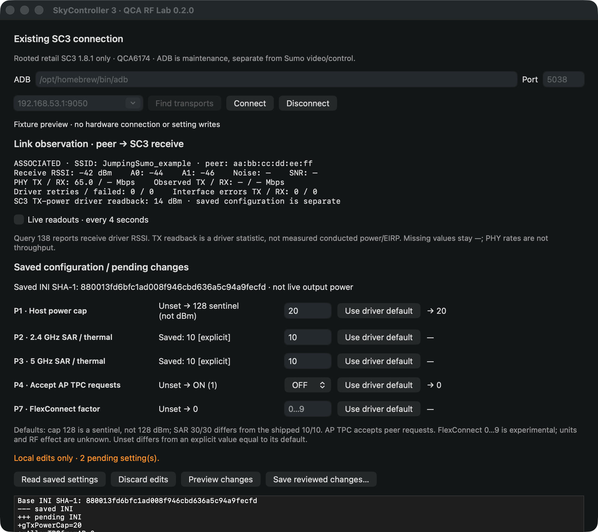
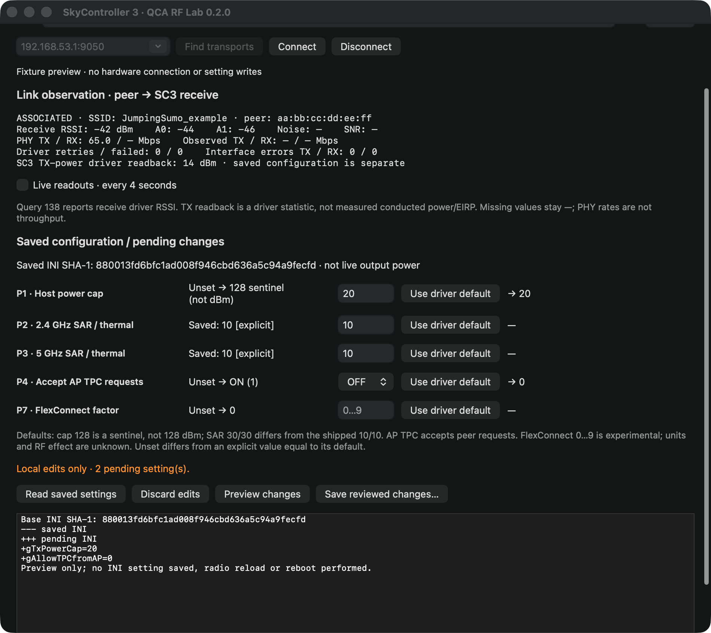

# Native SkyController 3 RF Lab

Open **Tools → SkyController 3 RF Lab…** in any vehicle mode. This is a separate
QCA6174 panel for the already-rooted retail SC3 on firmware **1.8.1**, not an SC2
Broadcom profile editor. It does not enable debugging or change the aircraft.

## Connection and observation

Choose an absolute host ADB executable (normally `/opt/homebrew/bin/adb`), the
existing server port **5038**, and the exact transport **192.168.53.1:9050**.
**Find transports** lists existing connections without choosing one for you.
Connect verifies UID0, `mpp3` and firmware before uploading anything. An absent
server, incompatible ADB protocol, wrong device or different firmware is refused.
No server start/kill, pairing, controller service, mppd or startup operation exists
in this client.

The checksummed RF Lab 0.2.0 script and static ARM RSSI helper are separate app
resources in `Resources/SC3RFLab`, independent of the older maintenance/mod and
native-Sumo video packages. Their RAM destination is
`/tmp/parrot-sc3-rf-lab-0.2.0`. Uploaded hashes and the helper self-test are checked;
missing RAM tools after a reboot are restored only after device verification.

Connect takes one observation. Enable **Live readouts** for serialized four-second
polling. Polling pauses during editing/other panel work; closing/disconnecting
retires its generation and cancels the owned host process. It never disconnects
the Sumo control/video transport. A failed connection clears old observations.

Metrics are read from the existing ANSI-free snapshot's raw link/station/vendor
sections and interface counters, not a fabricated machine snapshot schema.
Observed byte rates require two samples with the same peer and increasing uptime
and counters. First samples, resets and disconnects show unavailable rates.
Receive direction is **peer → SC3**. Query138 chain RSSI and TX-power driver
readback are not measurements of SC3 conducted power or EIRP. Missing noise,
SNR, RX PHY rate or counters remain unavailable. Zero driver counters do not prove
zero over-air retries.

## Staging and saving

| Editable field | New explicit values | Driver default when unset |
| --- | --- | --- |
| P1 `gTxPowerCap` | 1–30 | 128 sentinel, not128dBm |
| P2 `TxPower2g` | 1–30, SAR/thermal | 30 |
| P3 `TxPower5g` | 1–30, SAR/thermal | 30 |
| P4 `gAllowTPCfromAP` | ON/OFF | ON /1 |
| P7 `gFlexConnectPowerFactor` | 0–9, experimental, units unknown | 0 |

Each row has an independent **Use driver default** action. Unset is distinct from
an explicit default value. Shipped SAR10/10 differs from compiled defaults30/30.
Unusual saved values such as cap128 are displayed and preserved without clamping.
Invalid or ambiguous files block saving; the GUI does not auto-repair them.

1. Connect or **Read saved settings**. The app validates the exact settings JSON
   schema, version, five rows, numeric-string/null representation and INI digest.
   It also checks the actual INI for duplicate selected keys, invalid entries,
   missing/repeated END or active content after END.
2. Edit locally. Invalid text blocks preview/save while preserving the other edits.
   Discard changes explicitly; closing/refreshing/reconnecting with pending edits
   asks before discarding them. No edit, toggle or refresh writes the INI.
3. **Preview changes** sends the exact allowlisted pairs with the saved SHA-1 and
   displays the backend's actual returned diff. Any further edit retires it.
4. **Save reviewed changes…** requires separate consent and typing **APPLY**. The
   app sends the same reviewed pairs/hash. RF saves and the SC3 video-startup
   installer cannot overlap through the app.
5. Require remote success and reread the saved file. A matching readback says
   **saved; activation not verified**. No automatic reboot/reload follows. A stale
   hash is refused. A timeout, missing/malformed status or disconnect is unknown:
   reread settings, never retry a write automatically. Failed readback blocks
   further saving until reconnect/review.

Each non-TTY command has an unpredictable checked remote-status trailer; local
ADB exit0 alone is insufficient. Remote stderr is captured separately in a
private temporary file and is never mixed into settings JSON. Host output,
timeouts and cancellation are bounded. Only the five setting keys are writable.

Preserved-original/backup recovery remains in the existing interactive RF Lab
tool. There is no guessed stock INI, unrestricted upload, factory-reset button,
runtime RF setter, regulatory/BDF/calibration edit, logging/export action or
active throughput probe in this panel.

## Validation and boundaries — 2026-10-27

Host checks:

- 43 backend RF Lab and7 registry tests pass; both shell scripts pass syntax checks.
- `--self-test-sc3-rf`: JSON/null/default/invalid/duplicate handling, sentinel
  preservation, five-field staging/discard/default/diff, stale hash, allowlists,
  remote failure/trailers, wrong UID/model/version before upload, missing RAM
  tools, resource corruption, output bounds, owned-process cancellation, retired
  UI callbacks, uncertain-write reconciliation and mismatched save readback.
- Strict warnings-as-errors debug and optimized release builds; full app suites,
  signed staged/installed suites, signature/resource verification and diff checks.

Actual selected SC3: UID0 /mpp3 /1.8.1, RAM tool verification, helper self-test,
settings/INI decode, observation and all-five-key preview passed. Before/after
INI SHA-1 stayed `5c39192ce4154cb9d2b8c12a859923e0a49af4f7`. No apply, remount,
reboot, driver reload, pairing, controller service or startup change was issued.
The controller was **unassociated**, so paired chain/rate readouts, sustained
polling beside Sumo video/control, physical apply and actual RF effects remain
hardware validation. Do not treat the fixture screenshots as device readings.

Installed-app UI checks also passed: the Tools item opened the native panel;
transport discovery, connection, saved-value readback and an actual cap20 preview
worked. Cancelling the save dialog preserved the local draft; discarding and
rereading retained the original hash and saved cap30. No APPLY was entered.

Safe manual checks: select the exact transport, connect, toggle live readouts,
stage all five fields, preview, cancel and discard; confirm the INI is unchanged.
With a paired vehicle, verify SSID/peer and available chain readings, then unplug
USB: old readings must clear and saving must become unavailable. Reconnect,
reread and preview again; old diffs must not authorize a new save. A real save
needs the owner's explicit direction; no RF improvement is claimed by readback.

Source changes: `SC3RFModel.swift`, `SC3RFClient.swift`, `SC3RFWindow.swift`,
`SC3RFSelfTest.swift`; menu/lifecycle hooks in `AppDelegate.swift` and
`MainViewController.swift`; self-test/developer commands in `main.swift` and
`SelfTest.swift`; local resource-copy addition in `scripts/build-app.sh`.
The backend, root/mod manifest, video/mapping helpers and distributable are unchanged.

Fixture-only UI captures:

